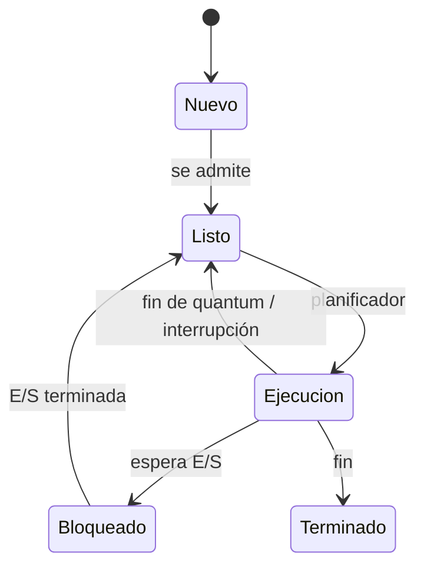

# Materia completa: Introducción a los Sistemas Operativos

> [!abstract] Un solo archivo
> Las cuatro unidades, en orden: Unidad → Tema → Subtema. Para leer de corrido sin abrir nada más. Cada unidad también existe por separado en su carpeta.

## Índice rápido
- [[#Unidad 1 — Introducción al sistema operativo — completa]]
- [[#Unidad 2 — Procesos y planificación — completa]]
- [[#Unidad 3 — Administración de memoria (asignación contigua) — completa]]
- [[#Unidad 4 — Memoria virtual — completa]]


---

## Unidad 1 — Introducción al sistema operativo — completa

> [!abstract] Qué pide la unidad
> Qué es un sistema operativo, para qué existe, cómo se separa del hardware y de los programas de usuario, y cómo evolucionó. Base de todo lo demás: sin esto no se entiende por qué existen procesos, memoria virtual ni llamadas al sistema.

> [!info] Cómo leer este archivo
> Es la unidad entera, en orden: Tema → Subtema. Cada subtema tiene su nota propia en la carpeta del tema, por si querés estudiar uno solo.


---

### Tema 1.1 — Qué es un sistema operativo


#### 1.1.1 Definición y funciones

> [!abstract] En una frase
> El **sistema operativo (SO)** es el programa (o conjunto de programas) que se ubica entre el **hardware** y las **aplicaciones**: les da una máquina **más simple** (abstracción) y **administra** los recursos (CPU, memoria, E/S, archivos) de forma ordenada y protegida.

##### Desarrollo
Una computadora es un sistema complejo: uno o más procesadores, memoria principal, discos, impresoras, teclado, red y otros dispositivos. Si cada programador tuviera que entender todo eso, no escribiría código. Por eso el SO cumple **dos funciones principales**:

| Función | Qué significa | Ejemplo |
|---|---|---|
| **Abstracción** (máquina extendida) | Oculta el hardware y ofrece objetos simples: archivos, procesos, sockets | Un programa hace `read()` de un archivo; no necesita saber en qué sector del disco está |
| **Administración de recursos** | Decide quién usa qué recurso, cuánto y cuándo; media en los conflictos | Dos impresiones simultáneas se encolan en vez de mezclarse en el papel |

Funciones secundarias que suelen mencionarse: **protección y seguridad** (aislar procesos entre sí), **servicios a los programas** (llamadas al sistema), **contabilidad** del uso de recursos e **interfaz** con el usuario.

> [!note] Dato de escala (Tanenbaum)
> El código de un SO como Linux o Windows ronda los **5 millones de líneas**. Por eso un SO evoluciona durante décadas y casi nunca se reescribe desde cero.

##### Cómo responderlo en el final
1. Definición en una frase: intermediario entre hardware y programas.
2. Función 1, **abstracción**, con el ejemplo del archivo.
3. Función 2, **administración de recursos**, con el ejemplo de la impresora o la memoria.
4. Cerrar con protección como función secundaria.

> [!warning] Errores típicos
> - Decir que el SO **es** lo que ve el usuario (eso es el shell o la GUI; ver 1.1.2).
> - Confundir **abstracción** (simplifica la vista) con **administración** (reparte el recurso real).


#### 1.1.2 Kernel, shell y programas del sistema

> [!abstract] En una frase
> El **kernel** es el núcleo del SO y corre en modo privilegiado. El **shell** (o la GUI) es un programa de **usuario** que traduce lo que escribe el usuario en llamadas al sistema: **no es parte del SO**.

##### Desarrollo
- **Kernel:** administra CPU, memoria, E/S e interrupciones, y ofrece las llamadas al sistema.
- **Shell:** intérprete de comandos. Basado en texto (bash, cmd) o gráfico (GUI). Si lo reemplazás por otro shell, el SO sigue igual.
- **Programas del sistema vs. de aplicación:** los primeros administran la operación de la máquina (el SO y sus utilidades); los segundos dan servicio al usuario (navegador, editor).
- Compiladores, editores e intérpretes de comandos **no son parte del SO** (cátedra). Tampoco el programa que permite cambiar la contraseña: se ejecuta en modo usuario aunque haga algo delicado.

#### Ejemplo: un shell simple (TP1, pregunta 13)
```c
while (TRUE) {
    type_prompt();                      // muestra el prompt
    read_command(command, parameters);  // lee la línea del usuario
    if (fork() != 0) {                  // el padre crea un hijo y espera
        waitpid(-1, &status, 0);
    } else {                            // el hijo reemplaza su imagen por el comando
        execve(command, parameters, 0);
    }
}
```
- `fork()` crea un **proceso hijo** idéntico al shell. En el padre devuelve el PID del hijo (≠ 0); en el hijo devuelve **0**.
- El padre espera con `waitpid` a que termine el hijo, y vuelve a mostrar el prompt.
- El hijo ejecuta `execve`, que **reemplaza** su programa por el comando pedido (`ls`, `cp`…).
- Todo esto son **llamadas al sistema**: el shell en sí no toca el disco ni la CPU, pide servicios al kernel.

##### Cómo responderlo en el final
"El shell es un programa de usuario que lee el comando y pide al kernel que lo ejecute con `fork` + `execve`; el kernel es el que realmente administra el hardware."

> [!warning] Errores típicos
> - "El shell es parte del SO porque el usuario lo usa." **No**: se ejecuta en modo usuario y se puede cambiar.
> - Olvidar que `fork` devuelve valores distintos en padre e hijo.


---

### Tema 1.2 — Modos de operación y llamadas al sistema


#### 1.2.1 Modo usuario y modo kernel

> [!abstract] En una frase
> El hardware tiene **dos modos**: **kernel** (o supervisor), con acceso a todas las instrucciones, y **usuario**, con un subconjunto limitado. Solo el SO corre en kernel; cualquier otro programa pasa a kernel únicamente mediante una interrupción o una llamada al sistema.

##### Desarrollo
| | Modo kernel / supervisor | Modo usuario |
|---|---|---|
| Quién corre | El kernel del SO | Aplicaciones, shell, bibliotecas |
| Instrucciones | Todas, incluidas las **privilegiadas** | Solo un subconjunto |
| Acceso a E/S y memoria ajena | Sí | No (la protección del hardware lo impide) |

**Instrucciones privilegiadas** (que solo puede ejecutar el kernel): cambiar el mapa de memoria, deshabilitar interrupciones, grabar el reloj del día, controlar dispositivos de E/S.

#### Ejercicio TP1, pregunta 7
| Instrucción | ¿Solo en kernel? | Por qué |
|---|---|---|
| a. Cambiar el mapa de memoria | **Sí** | Podría dar acceso a la memoria de otro proceso |
| b. Leer la hora del día | No | Es una lectura inofensiva; no altera al resto del sistema |
| c. Grabar la hora del día | **Sí** | Alteraría la hora para todos los procesos |
| d. Deshabilitar todas las interrupciones | **Sí** | Un programa podría acaparar la CPU para siempre |

**Respuesta:** a, c y d.

#### ¿Por qué el código del SO debe ser lo más chico posible?
Todo lo que corre en kernel tiene poder total: un error ahí puede tirar abajo todo el sistema o comprometer la seguridad. Por eso la idea subyacente es **minimizar la parte privilegiada**: lo que no necesita ser kernel se saca a modo usuario (cuanto menos código privilegiado, menos superficie de error y más fácil de verificar).

##### Cómo responderlo en el final
"Hay dos modos. En kernel se ejecuta el SO con todas las instrucciones; en usuario, los programas con un subconjunto. El cambio se hace por interrupción o llamada al sistema. El código del SO debe ser mínimo porque todo lo que está en kernel puede dañar al sistema entero."

> [!warning] Errores típicos
> - Decir que "el usuario corre en modo usuario y el SO en modo supervisor" sin explicar **por qué** importa la protección.
> - Olvidar que leer la hora **no** es privilegiado y grabarla sí.


#### 1.2.2 Llamadas al sistema

> [!abstract] En una frase
> Una **llamada al sistema** es el mecanismo por el que un programa en modo usuario pide un servicio al kernel: coloca los parámetros, ejecuta una instrucción **TRAP** que cambia a modo kernel, el kernel hace el trabajo y devuelve el control.

##### Desarrollo
Secuencia típica (ejemplo UNIX: `count = read(file, buffer, nbytes);`):
1. El programa llama a un **procedimiento de biblioteca** (`read`).
2. Ese procedimiento coloca los parámetros en lugares convenidos (típicamente registros).
3. Ejecuta la instrucción **TRAP** (una "llamada a procedimiento protegida") que pasa a modo kernel.
4. El kernel identifica la llamada, la ejecuta y **vuelve a modo usuario** con el resultado.

Familias de llamadas POSIX (la cátedra las lista por categoría):
- **Procesos:** `fork`, `execve`, `waitpid`, `exit`.
- **Archivos:** `open`, `read`, `write`, `close`, `unlink`.
- **Comunicación:** `pipe`, `socket`, `send`, `recv`.
- **Varias:** `chdir`, `time`/reloj, señales.

> [!important] Llamada al sistema ≠ función de biblioteca
> Desde el código **se ven igual** (es una función con parámetros y retorno), pero no todas las funciones de biblioteca hacen una llamada al sistema: `strlen` o un `printf` sin vaciar el buffer no cruzan a kernel. **Sí importa** que el programador lo sepa, porque una syscall es más **costosa** (cambio de modo), puede **bloquear** el proceso, depende del sistema operativo (**portabilidad**) y puede **fallar** (hay que revisar el valor de retorno).

##### Cómo responderlo en el final
"Un programa pide un servicio con una función de biblioteca que ejecuta TRAP; el kernel valida, ejecuta y devuelve. Desde el código parece una función común, pero cambia el modo de ejecución y tiene costo y posibles bloqueos."

> [!warning] Errores típicos
> - Decir que "la syscall es una función más" sin mencionar el cambio a modo kernel.
> - Creer que todo lo de la biblioteca estándar es una syscall.


---

### Tema 1.3 — Historia y tipos de sistemas operativos


#### 1.3.1 Generaciones de computadoras y su SO

> [!abstract] En una frase
> La historia del SO es la historia de **reducir el tiempo que la máquina cara pasa esperando al operador**: de los paneles de control a los lotes, luego multiprogramación y tiempo compartido, y por último la PC.

##### Desarrollo
| Generación | Años | Tecnología | Sistema operativo |
|---|---|---|---|
| **1.ª** | 1945–1955 | Tubos de vacío | No hay SO ni lenguajes: se programa en lenguaje de máquina con paneles y, después, tarjetas perforadas |
| **2.ª** | 1955–1965 | Transistores | **Sistemas por lotes** (batch): el antecesor del SO (IBM 1401 y 7094) |
| **3.ª** | 1965–1980 | Circuitos integrados | **Multiprogramación, spooling y tiempo compartido** (OS/360, Multics → UNIX) |
| **4.ª** | desde 1980 | Integración a gran escala | PC, redes y sistemas distribuidos: CP/M, DOS, UNIX, Windows, Linux, Android |

#### El procedimiento de la 2.ª generación (TP1, pregunta 10)
1. El programador escribe el programa en **tarjetas perforadas**.
2. Un operador (con el **IBM 1401**, de bajo costo) lee las tarjetas y las copia a una **cinta** de entrada.
3. El **IBM 7094** (el de cálculo) lee la cinta, procesa el trabajo y escribe el resultado en otra cinta.
4. El 1401 lee esa cinta y **imprime** los resultados.

**Analogía con hoy:** las tarjetas son el archivo que subís a una cola; la cinta es el **spool en disco**; el 7094 es la CPU; la impresora es la cola de impresión. Lo que cambió: hoy el **SO** hace la cola y la planificación, hay discos y controladores de E/S que trabajan en paralelo con la CPU (y DMA, ver 1.4.3), y no hace falta mover cintas a mano.

##### Cómo responderlo en el final
Dar la tabla en tres renglones (generación → tecnología → SO) y, si piden el procedimiento, recitar los 4 pasos del 1401/7094 y su equivalente actual.

> [!warning] Errores típicos
> - Mezclar generación (hardware) con tipo de SO (uso).
> - Decir que la 2.ª generación ya tenía multiprogramación: no, eso es de la 3.ª.


#### 1.3.2 Multiprogramación, spooling y tiempo compartido

> [!abstract] En una frase
> **Multiprogramación:** varios procesos en memoria y la CPU alterna entre ellos. **Spooling:** las E/S se encolan en disco y se procesan a su ritmo. **Tiempo compartido:** muchos usuarios en terminales reciben la CPU por turnos cortos.

##### Desarrollo
#### Multiprogramación
Mientras un proceso espera una E/S (lenta), otro usa la CPU. Se justifica por dos razones (TP1, pregunta 8):
1. **Aprovechar la CPU:** se reducen los tiempos muertos en que la CPU espera al disco o a la impresora.
2. **Mejorar la respuesta y el uso de recursos:** varios trabajos avanzan a la vez en vez de hacerse uno detrás del otro.

Se formaliza con el modelo probabilístico (ver 2.5.2).

#### Spooling
*Simultaneous Peripheral Operations On-Line*. Los datos destinados a un dispositivo lento (impresora) se guardan en un área intermedia (disco) y el dispositivo los consume después. La CPU queda libre apenas escribió en la cola.
- **Ejemplos:** cola de impresión; cola de envío de correo; lectura de tarjetas en el 1401.
- **¿Se usa hoy?** Sí: es la base de las colas de impresión y de cualquier buffer de E/S.
- **¿Por qué no en la 2.ª generación?** No había multiprogramación que aprovechara esa libertad de la CPU, y el almacenamiento intermedio era cinta, lenta y secuencial; el disco aún no era la base de la E/S.

#### Tiempo compartido
Varias terminales conectadas a la misma máquina. La CPU da a cada usuario un **quantum** breve, y la alternancia es tan rápida que cada uno siente que la máquina es suya. Multics (MIT, Bell, General Electric) fue el precursor, y de ahí sale UNIX.

##### Cómo responderlo en el final
Definir las tres en una frase cada una, dar un ejemplo de spooling y decir que la multiprogramación es lo que hace posible el tiempo compartido.

> [!warning] Errores típicos
> - Confundir spooling con multiprogramación: el spooling es para **E/S**, la multiprogramación para **CPU**.
> - Decir que el tiempo compartido es "multiprogramación sin quantum": el quantum es lo que lo define.


#### 1.3.3 Tipos de sistemas operativos

> [!abstract] En una frase
> El SO cambia según el **uso**: por lotes, interactivo o de tiempo real en la clasificación clásica; y mainframe, servidor, PC, móvil o embebido según el equipo.

##### Desarrollo
Según el tipo de equipo (cátedra):
- **Mainframe:** gran capacidad de E/S, muchos trabajos.
- **Servidores:** impresión, web, archivos.
- **Multiprocesadores:** varios CPU en un mismo sistema.
- **Computadoras personales.**
- **PDA / handheld** y **móviles** (Android, iOS).
- **Integrados o embebidos.**
- **Nodos sensores.**
- **En tiempo real:** la respuesta tiene un plazo garantizado (deadline).

Según el **criterio de servicio** (útil para planificación, ver Unidad 2):
- **Por lotes:** se busca rendimiento (trabajos completados por hora).
- **Interactivo:** se busca tiempo de respuesta corto.
- **Tiempo real:** se busca cumplir plazos.

##### Cómo responderlo en el final
Clasificar por equipo en una lista corta y, si piden "tipo de SO", dar el criterio de servicio y ejemplificar con uno de cada uno.

> [!warning] Errores típicos
> - Llamar "tipo" a la generación o al contrario.


---

### Tema 1.4 — Sistemas de archivos, E-S y máquinas virtuales


#### 1.4.1 Sistema de archivos y directorios

> [!abstract] En una frase
> El **sistema de archivos** organiza los datos del disco en archivos con nombre, agrupados en **directorios** jerárquicos, y los ofrece al proceso como una abstracción simple, sin que vea sectores ni bloques.

##### Desarrollo
- **Archivo:** unidad lógica con nombre; el usuario no sabe dónde está en el disco.
- **Directorio:** agrupa archivos; permite jerarquías (árboles). Cada archivo tiene una **ruta (path)** desde la **raíz**.
- **Directorio de trabajo:** en cada instante, cada proceso tiene uno, y las rutas relativas se resuelven desde ahí.
- **Montaje:** en UNIX/Linux, dispositivos externos (CD, USB, discos) se **montan** sobre el árbol de la raíz; no hay "letras" de unidad.

#### Raíz: UNIX/Linux vs. Windows (TP1, pregunta 15)
| | UNIX / Linux | Windows |
|---|---|---|
| Raíz | Una sola: `/`. Todo cuelga de ahí | Una raíz **por unidad**: `C:\`, `D:\` |
| Dispositivos | Se montan dentro del árbol (`/mnt/usb`) | Reciben una letra propia |

#### ¿Qué es un sistema de archivos? (TP1, pregunta 21)
La forma en que el SO organiza el almacenamiento: nombres, metadatos (tamaño, dueño, permisos, fechas), asignación de bloques del disco a cada archivo y control de acceso.

##### Cómo responderlo en el final
"El sistema de archivos abstrae el disco en archivos y directorios con rutas desde una raíz. En UNIX hay una sola raíz y los discos se montan; en Windows hay una raíz por unidad."

> [!warning] Errores típicos
> - Creer que el archivo "es" el sector del disco.
> - Olvidar el directorio de trabajo al hablar de rutas relativas.


#### 1.4.2 Archivos especiales de bloque y de caracteres

> [!abstract] En una frase
> Los **archivos especiales** modelan dispositivos de E/S como si fueran archivos. **De bloque:** accesibles al azar, por bloques (disco). **De caracteres:** flujo secuencial de caracteres (impresora, terminal).

##### Desarrollo
| | De bloque | De caracteres |
|---|---|---|
| Acceso | Bloques **direccionables al azar** (se puede leer el bloque 500 sin leer el 499) | **Flujo secuencial**, un carácter tras otro |
| Ejemplo típico | Disco, SSD, CD | Impresora, terminal, teclado, puerto serie |
| Por qué | Modela un dispositivo con "posiciones" | Modela un dispositivo que "emite o recibe" datos |

Otro pseudo-archivo que aparece en la cátedra: el **pipe** (canal), que enlaza procesos (ver 2.6.1).

##### Cómo responderlo en el final
"Un archivo de bloque representa un dispositivo con posiciones direccionables, como un disco; uno de caracteres, un dispositivo que transmite un flujo, como una impresora."

> [!warning] Errores típicos
> - Invertir los nombres. Regla fácil: **bloque = disco** (se accede por bloques), **caracteres = impresora/terminal**.


#### 1.4.3 E-S programada, interrupciones, DMA

> [!abstract] En una frase
> En la **E/S programada** la CPU copia cada byte del dispositivo a la memoria. Con **DMA** un controlador hace esa copia en bloque y avisa con una **interrupción** al terminar, liberando a la CPU.

##### Desarrollo
#### Sin DMA (TP1, pregunta 17)
Si cada byte lo lee o escribe la CPU, aparecen tres problemas para la multiprogramación:
1. La CPU está **ocupada copiando** en vez de ejecutar otros procesos.
2. No hay **solapamiento** real entre cálculo y E/S: mientras el dispositivo trabaja, la CPU espera.
3. Cuantos más procesos hay, más tiempo de CPU se consume en E/S, y la multiprogramación pierde sentido.

#### Con DMA
El controlador de DMA recibe la dirección de memoria y el tamaño, transfiere el bloque y **genera una interrupción** al final: la CPU interviene una vez por bloque, no una vez por byte.

#### Interrupciones
Señal que hace que la CPU deje lo que hace y ejecute una **rutina de servicio** del SO. Hay de hardware (dispositivo, reloj) y de software (señales, syscalls). Ver el procedimiento completo en 2.2.2.

##### Cómo responderlo en el final
"Sin DMA la CPU copia byte a byte y se queda sin tiempo para otros procesos. Con DMA, el controlador mueve el bloque y avisa con una interrupción."

> [!warning] Errores típicos
> - Decir que DMA "hace la E/S más rápida": lo que hace es **liberar la CPU**.


#### 1.4.4 Máquinas virtuales, hipervisor, JVM y CLR

> [!abstract] En una frase
> Una **máquina virtual** simula una computadora completa sobre una real. El **hipervisor** reparte el hardware físico entre varias VMs aisladas. La **JVM** y el **CLR** son máquinas virtuales de **proceso**: simulan un entorno de ejecución, no el hardware entero.

##### Desarrollo
- **Hipervisor (monitor de VM):** divide CPU, memoria y dispositivos entre las VMs y las aísla, como si fueran máquinas distintas.
- **Usos:** correr varios SO en una misma máquina física, pruebas, servidores aislados.
- **JVM / .NET CLR (TP1, pregunta 22):** no simulan todo el hardware; ejecutan **bytecode** (o IL) en un entorno que administra memoria y tipos. Una VM de proceso vive dentro de un SO; un hipervisor vive debajo de varios SO.

| | Hipervisor | JVM / CLR |
|---|---|---|
| Qué simula | Una computadora completa | Un entorno para un programa |
| Qué ejecuta | Otros sistemas operativos | Bytecode / IL |
| Dónde corre | Directamente sobre el hardware | Como un proceso más del SO |

##### Cómo responderlo en el final
"El hipervisor simula hardware completo para correr varios SO aislados. La JVM y el CLR son VMs de proceso: ejecutan bytecode y no reemplazan al SO."

> [!warning] Errores típicos
> - Llamar "máquina virtual" a la JVM como si simulara hardware físico.


#### 1.4.5 Práctica — consultar fecha y hora del sistema (TP1, preguntas 5 y 6)

> [!abstract] En una frase
> Un comando como `date` o un programa que lee la hora **pide** la fecha al kernel mediante una llamada al sistema; el kernel la lee del reloj de hardware y la devuelve al programa, que la muestra.

##### Desarrollo
Secuencia (válida para Linux y Windows):
1. El usuario escribe `date` (Linux) o `date /t` / `time /t` (Windows) en el shell.
2. El shell crea un proceso hijo y lo ejecuta (`fork` + `execve`, ver 1.1.2).
3. El programa llama a una función de biblioteca de tiempo, que hace la **llamada al sistema** correspondiente.
4. El kernel lee el **reloj de hardware** (RTC) y lo convierte a fecha y hora.
5. Devuelve el valor por el mecanismo de retorno; el programa lo formatea y lo imprime.

**Qué pasa dentro del SO** (pasos 3–4) y **qué pasa fuera** (el shell, el programa, la pantalla). La pregunta 6 pide lo mismo desde un programa propio (C#, VB .NET o C): el código llama a la API de fecha y la biblioteca de .NET termina en una syscall.

> [!tip] Para el oral
> Describí la cadena: **usuario → shell → proceso hijo → biblioteca → syscall (TRAP) → kernel → reloj de hardware → vuelta a modo usuario → pantalla**.

##### Cómo responderlo en el final
Recitar la cadena de arriba. Es la pregunta que más une teoría (modo kernel, syscall, fork) con práctica.


---

## Unidad 2 — Procesos y planificación — completa

> [!abstract] Qué pide la unidad
> El proceso es la unidad de trabajo del SO: qué es, qué información lo describe, cómo cambia de estado, cómo se reparte la CPU entre varios y cómo se comunican. Incluye el modelo probabilístico de multiprogramación, que es el ejercicio más repetido de los parciales.

> [!info] Cómo leer este archivo
> Es la unidad entera, en orden: Tema → Subtema. Cada subtema tiene su nota propia en la carpeta del tema, por si querés estudiar uno solo.


---

### Tema 2.1 — Proceso y programa


#### 2.1.1 Programa vs. proceso

> [!abstract] En una frase
> Un **programa** es un archivo pasivo guardado en disco (código e instrucciones). Un **proceso** es ese programa **en ejecución**: una entidad activa, en memoria, con recursos asociados. Un mismo programa puede dar origen a muchos procesos.

##### Desarrollo
| | Programa | Proceso |
|---|---|---|
| Naturaleza | Pasivo: un archivo | Activo: en ejecución |
| Dónde vive | Memoria secundaria (disco, SSD) | Memoria principal (RAM) |
| Qué contiene | Código y datos iniciales | Código, datos, heap, pila, registros, PCB |
| Cantidad | Uno | Puede haber muchos del mismo programa |

**Qué forma un proceso:** código del programa; datos (variables globales, heap); una o más **pilas** (llamadas y variables locales); registros (contador de programa, puntero de pila, registros generales); y el **PCB** (ver 2.1.2).

**Ejemplo:** abrir tres veces el bloc de notas = un programa, tres procesos.

##### Cómo responderlo en el final
"El programa es el archivo ejecutable en disco; el proceso es la instancia en ejecución, con su código, datos, pila, registros y PCB en memoria. Del mismo programa puede haber varios procesos."

> [!warning] Errores típicos
> - Decir que "el proceso es el programa". Es el programa **en ejecución**.


#### 2.1.2 El PCB (Process Control Block)

> [!abstract] En una frase
> El **PCB** es la estructura de datos del SO que guarda todo lo necesario para **retomar** un proceso: su identidad, su estado, sus registros, su información de memoria y de archivos, y sus estadísticas.

##### Desarrollo
| Bloque | Contenido típico |
|---|---|
| Identificación | PID, PID del padre, usuario y grupo propietario |
| Estado | Nuevo, listo, ejecución, bloqueado, suspendido, terminado; prioridad |
| Contexto de CPU | Contador de programa, registros generales, puntero de pila |
| Memoria | Registros base y límite, o punteros a tablas de páginas / segmentos |
| Archivos | Tabla de archivos abiertos, directorio de trabajo |
| Estadísticas | Tiempo de CPU usado, fallos de página, tiempos de espera |

**Cambio de contexto:** el SO **guarda** el estado del proceso que deja la CPU en su PCB y **carga** el PCB del que la toma. Ese trabajo es el costo del cambio de contexto (aparece en 2.4.2 como sobrecarga).

##### Cómo responderlo en el final
Enumerar cuatro bloques (identificación, estado, contexto de CPU, memoria) y explicar que el PCB es lo que permite interrumpir y retomar un proceso.

> [!warning] Errores típicos
> - Confundir PCB con "la tabla de páginas": la tabla de páginas es **un campo** del PCB.


#### 2.1.3 Creación, jerarquía y señales

> [!abstract] En una frase
> Los procesos nacen y mueren por **llamadas al sistema**; forman un árbol padre-hijo; cada uno tiene un usuario y un grupo, y se controlan con **señales**, análogas a las interrupciones de hardware.

##### Desarrollo
- **`fork()`:** crea un hijo que es copia del padre. Devuelve 0 en el hijo y el PID del hijo en el padre.
- **`execve()`:** reemplaza el programa del proceso actual por otro. El PID no cambia.
- **`waitpid()`:** el padre espera a que termine un hijo.
- **`exit()`:** termina el proceso y devuelve un código al padre.
- **Señales:** mecanismo de software para notificar eventos (equivalente a una interrupción, pero entregada por el SO al proceso).

Estructura del shell (TP1, pregunta 13): `fork` + `execve` en el hijo y `waitpid` en el padre (ver 1.1.2).

##### Cómo responderlo en el final
"El padre crea al hijo con fork; el hijo reemplaza su imagen con execve; el padre espera con waitpid. Así es como funciona cualquier comando de la línea de comandos."

> [!warning] Errores típicos
> - Olvidar que `execve` **no** crea un proceso nuevo: reemplaza el programa del actual.


---

### Tema 2.2 — Estados, transiciones e interrupciones


#### 2.2.1 Estados de un proceso y transiciones

> [!abstract] En una frase
> Un proceso está en **nuevo, listo, ejecución, bloqueado** o **terminado**. Pasa de uno a otro por decisiones del planificador (listo ↔ ejecución) o por eventos (ejecución → bloqueado al pedir E/S; bloqueado → listo al terminar la E/S).

##### Desarrollo


| Transición | Causa |
|---|---|
| Nuevo → Listo | El SO crea el proceso y lo pone en la cola de listos |
| Listo → Ejecución | El planificador le asigna la CPU |
| Ejecución → Listo | Se agota el quantum o llega uno de mayor prioridad |
| Ejecución → Bloqueado | Pide E/S o espera un recurso |
| Bloqueado → Listo | Se completa el evento. **No** pasa directo a ejecución: primero espera su turno |
| Ejecución → Terminado | Termina normalmente o por error |

**Estados suspendidos** (modelos más completos): listo-suspendido y bloqueado-suspendido, cuando el proceso fue llevado a disco por swapping (ver 3.3.2).

##### Cómo responderlo en el final
Dibujar el diagrama de 5 estados, marcar las 4 transiciones con su causa, y remarcar que bloqueado → listo no es bloqueado → ejecución.

> [!warning] Errores típicos
> - Dibujar bloqueado → ejecución directamente.


#### 2.2.2 Interrupción y cambio de contexto (pasos)

> [!abstract] En una frase
> Cuando ocurre una interrupción, el hardware guarda el contador de programa, salta a la rutina de atención, el SO guarda registros, decide qué proceso sigue (planificador) y restaura el elegido.

##### Desarrollo
Pasos del nivel inferior del SO ante una interrupción (cátedra, Procesos y memoria):
1. El **hardware** guarda el contador de programa en la pila (y el estado mínimo).
2. El hardware carga el **nuevo contador de programa** desde el vector de interrupciones.
3. Una rutina en **ensamblador** guarda los registros generales.
4. La rutina en ensamblador establece la **nueva pila**.
5. Se ejecuta el **servicio de interrupción en C** (por lo general lee y guarda la entrada en un buffer).
6. El **planificador** decide qué proceso sigue.
7. El procedimiento en C **regresa** al ensamblador.
8. El ensamblador **restaura** el proceso elegido y lo ejecuta.

> [!tip] Cómo recordarlo
> "Hardware guarda y salta → ensamblador guarda registros y pila → C atiende → planificador elige → ensamblador restaura." Son tres capas: hardware, ensamblador, C.

##### Cómo responderlo en el final
Recitar las capas: hardware, ensamblador, C, planificador, y de vuelta. Si piden el detalle, dar los 8 pasos en orden.


---

### Tema 2.3 — Hilos


#### 2.3.1 Proceso vs. hilo

> [!abstract] En una frase
> Un **hilo** (thread) es una unidad de ejecución **dentro** de un proceso. Los hilos de un mismo proceso comparten memoria y recursos; cada uno tiene solo su pila, sus registros y su contador de programa. Por eso cambiar de hilo es más liviano que cambiar de proceso.

##### Desarrollo
| | Proceso | Hilo |
|---|---|---|
| Espacio de memoria | Propio y aislado | Compartido con los hilos del mismo proceso |
| Recursos (archivos, PCB) | Propios | Compartidos |
| Propio de cada uno | Todo | Pila, registros, contador de programa, estado |
| Cambio de contexto | Pesado (cambia el mapa de memoria) | Liviano |
| Protección entre sí | Fuerte | Ninguna: un hilo puede corromper a otro |

##### Cómo responderlo en el final
"El proceso es el contenedor con aislamiento; el hilo es la unidad de ejecución que comparte todo con sus hermanos. Cambiar de hilo es más barato porque no cambia el mapa de memoria."

> [!warning] Errores típicos
> - Decir que los hilos "tienen su propia memoria": comparten el espacio de direcciones.


---

### Tema 2.4 — Planificación de la CPU


#### 2.4.1 Objetivos de la planificación

> [!abstract] En una frase
> El **planificador** decide qué proceso listo recibe la CPU y por cuánto tiempo. Sus objetivos son usar bien la CPU, responder rápido, reducir la espera y cumplir prioridades o plazos; cuál pesa más depende del tipo de sistema.

##### Desarrollo
Objetivos típicos (parcial, pregunta 21):
- Maximizar la **utilización de CPU**.
- Minimizar el **tiempo de respuesta** (sistemas interactivos).
- Minimizar el **tiempo de espera** promedio en la cola de listos.
- Maximizar el **rendimiento**: procesos terminados por unidad de tiempo.
- Respetar **prioridades** y, en tiempo real, los **plazos**.

**Factores que inciden en la eficiencia** (pregunta 25): el algoritmo, el quantum, la relación CPU/E-S de los procesos, la carga (cantidad de procesos), las prioridades y aging, y el costo del cambio de contexto.

##### Cómo responderlo en el final
Dar el criterio según el tipo de sistema: por lotes → rendimiento; interactivo → respuesta; tiempo real → plazos.


#### 2.4.2 FIFO, SJF y Round Robin (quantum)

> [!abstract] En una frase
> **FIFO** atiende en orden de llegada, sin expulsión. **SJF** elige el trabajo más corto (minimiza la espera promedio, pero necesita estimarlo). **Round Robin** da a cada proceso un **quantum** y lo manda al final de la cola si no terminó.

##### Desarrollo
#### FIFO / FCFS
- Orden de llegada, **no expulsivo**: el proceso corre hasta terminar o bloquearse.
- Simple, pero un proceso largo que llega primero retrasa a todos (**efecto convoy**).

#### SJF (Shortest Job First)
- Ejecuta primero el de **menor tiempo de CPU** estimado. Minimiza la espera promedio.
- Variante expulsiva: **SRTF** (Shortest Remaining Time First).
- Problema: hay que **estimar** el tiempo de cada proceso.

#### Round Robin
- Pensado para **sistemas interactivos**. Cada proceso recibe un **quantum** (ej.: 25 ms).
- Si el quantum vence y no terminó, va al **final** de la cola de listos. Si terminó, sale.
- **Expulsivo:** garantiza que todos tengan turno.

**Quantum chico:** muchos cambios de contexto → sobrecarga alta.
**Quantum grande:** el sistema se comporta como FIFO → mala respuesta.

#### Ejemplo del parcial (pregunta 23)
Cambio de contexto = 6 ms; quantum = 25 ms. En cada ciclo se gastan 6 ms de sobrecarga y 25 ms útiles:
**sobrecarga = 6 / (6 + 25) = 6 / 31 ≈ 19,4 %.** La cátedra lo considera aceptable porque lo que pesa es la respuesta al usuario.

##### Cómo responderlo en el final
Dar la lógica de cada algoritmo en una línea, y para RR explicar el trade-off del quantum con el ejemplo de 6/31.

> [!warning] Errores típicos
> - Decir que SJF es el mejor para todo: necesita conocer la duración.
> - Olvidar que en RR un proceso que se bloquea antes del quantum cede la CPU antes.


#### 2.4.3 Prioridades, hambre y aging

> [!abstract] En una frase
> En **prioridades**, siempre corre el de mayor prioridad. Puede ser **expulsivo** (si llega uno más prioritario, desaloja al actual) o **no expulsivo**. El problema es el **hambre** (starvation) de los de baja prioridad; la solución es el **aging**: subir la prioridad cuanto más espera un proceso.

##### Desarrollo
| Variante | Cuándo cambia la CPU |
|---|---|
| No expulsiva | Cuando el proceso termina o se bloquea |
| Expulsiva | También cuando llega un proceso de mayor prioridad |

- **Hambre:** un proceso de baja prioridad puede no ejecutarse nunca si siempre hay otro más prioritario.
- **Aging:** la prioridad aumenta con el tiempo de espera; garantiza que, tarde o temprano, todos corran.

##### Cómo responderlo en el final
"Las prioridades pueden causar hambre; el aging soluciona el problema subiendo la prioridad de quien espera."


---

### Tema 2.5 — Multiprogramación y modelo probabilístico


#### 2.5.1 Multiprogramación — concepto y beneficios

> [!abstract] En una frase
> La **multiprogramación** mantiene **varios procesos en memoria** y alterna la CPU entre ellos: mientras uno espera E/S, otro usa la CPU. Sube la utilización de la CPU y reduce el tiempo muerto.

##### Desarrollo
- **Se incorpora en la 3.ª generación** (década de 1960).
- **Ventajas:** mayor utilización de CPU, menor tiempo de espera promedio, y posibilidad de **tiempo compartido** (varios usuarios "a la vez").
- **Condición:** necesita que haya **más de un proceso** en memoria y que los procesos pasen parte del tiempo en E/S.
- **Lo que hay que decidir:** cuántos procesos conviene tener en memoria para mantener la CPU ocupada. Esa pregunta la responde el modelo probabilístico (2.5.2).

##### Cómo responderlo en el final
Definición + "mientras uno espera E/S, otro usa la CPU" + la pregunta de cuántos procesos, que lleva a 2.5.2.


#### 2.5.2 Modelo probabilístico — U = 1 − pⁿ

> [!abstract] En una frase
> Si cada proceso pasa una fracción **p** de su tiempo esperando E/S y hay **n** procesos en memoria, la CPU está ociosa solo cuando **todos** esperan a la vez, con probabilidad **pⁿ**. Entonces la **utilización de CPU es U = 1 − pⁿ**.

##### Desarrollo
Supone que los procesos son independientes (cátedra, Procesos y memoria; parcial, preguntas 5, 24, 31 y 35).

| Símbolo | Significado |
|---|---|
| p | Fracción de tiempo de cada proceso **en espera de E/S** ("qué tan dependientes de E/S son") |
| n | Cantidad de procesos **en memoria** ("cuántos hay listos para aprovechar la CPU") |
| U | Fracción de tiempo en que la CPU está ocupada |

#### Tabla para p = 0,5
| n | pⁿ | U = 1 − pⁿ |
|---|---|---|
| 1 | 0,5 | 50 % |
| 2 | 0,25 | 75 % |
| 3 | 0,125 | 87,5 % |
| 4 | 0,0625 | 93,75 % |

**Pregunta típica:** "¿cuántos procesos para tener al menos 90 % de CPU con p = 0,5?" → 1 − 0,5ⁿ ≥ 0,9 ⇒ 0,5ⁿ ≤ 0,1 ⇒ **n = 4** (0,5³ = 0,125 > 0,1; 0,5⁴ = 0,0625 ≤ 0,1).

#### Otros ejemplos de la cátedra
- p = 0,75, n = 2: U = 1 − 0,5625 = **43,75 %**.
- p = 0,9, n = 3: U = 1 − 0,729 = **27,1 %**.
- p = 0,75 y **4 procesos** (TP2, pregunta 6): la CPU desperdicia 0,75⁴ = **31,6 %**, o sea U ≈ 68,4 %.
- p = 0,7 (TP2, pregunta 7): con 3 procesos U = 1 − 0,7³ = **65,7 %**; con 5, U = 1 − 0,7⁵ = **83,2 %**.

#### Limitaciones que conviene decir en el oral
- Supone independencia entre procesos.
- No modela la **memoria**: en la práctica, n está limitado por cuántos procesos entran en RAM (ver Unidad 3).
- Es una **estimación**; las simulaciones (TP2, pregunta 9) reproducen el comportamiento con más detalle.

##### Cómo responderlo en el final
"Si cada proceso espera E/S con probabilidad p, la CPU queda ociosa sólo si los n esperan a la vez: pⁿ. Entonces U = 1 − pⁿ." Y después un ejemplo numérico de la tabla.

> [!warning] Errores típicos
> - Confundir p (fracción en E/S) con la fracción de CPU (1 − p).
> - Calcular 1 − p·n en vez de 1 − pⁿ.


---

### Tema 2.6 — Comunicación y sincronización entre procesos


#### 2.6.1 Comunicación entre procesos (IPC)

> [!abstract] En una frase
> Los procesos se comunican por **pipes**, **colas de mensajes**, **memoria compartida** o **sockets**. Cada mecanismo cambia el costo y la necesidad de sincronizar.

##### Desarrollo
| Mecanismo | Cómo funciona | Ejemplo / nota |
|---|---|---|
| **Pipe** (tubería) | Un proceso escribe y otro lee; unidireccional (dos pipes para bidireccional) | `ls \| grep txt` en el shell |
| **Cola de mensajes** | El SO mantiene buzones; los procesos envían y reciben mensajes con formato | Buena para sistemas modulares o distribuidos |
| **Memoria compartida** | Varios procesos comparten una región de RAM | El método más rápido, pero **requiere sincronización** |
| **Socket** | Comunicación tipo red, también dentro de la misma máquina | Cliente / servidor |

##### Cómo responderlo en el final
Nombrar los cuatro, dar un ejemplo de pipe en el shell y remarcar que la memoria compartida exige semáforos o mutex.


#### 2.6.2 Sincronización y condiciones de carrera

> [!abstract] En una frase
> Cuando varios procesos o hilos usan el mismo dato sin control, el resultado depende del orden de ejecución: es una **condición de carrera**. La **sincronización** (regiones críticas, semáforos, mutex, monitores) la evita.

##### Desarrollo
- **Condición de carrera:** dos procesos leen y escriben la misma variable; uno puede leer un valor "a medio actualizar" o pisar el cambio del otro.
- **Región crítica:** el fragmento de código que accede al recurso compartido. Debe ejecutarse de a uno.
- **Herramientas:** **mutex** (exclusión mutua), **semáforos** (contadores), **monitores** (estructuras con sincronización incorporada); algoritmos de software como Peterson o hardware como TSL.
- **Ejemplo clásico:** el **productor–consumidor** con buffer compartido.
- Riesgos a mencionar: **interbloqueo** (deadlock) y **espera activa** innecesaria.

##### Cómo responderlo en el final
Definir la carrera con un ejemplo de dos procesos que incrementan la misma variable, y luego nombrar región crítica y semáforo/mutex.


---

## Unidad 3 — Administración de memoria (asignación contigua) — completa

> [!abstract] Qué pide la unidad
> Cómo el SO reparte la memoria RAM entre varios procesos sin paginación: relocación y protección, particiones fijas y variables, fragmentación, control de huecos (mapa de bits y listas enlazadas) y algoritmos de asignación. Es la base para entender por qué apareció la memoria virtual (Unidad 4).

> [!info] Cómo leer este archivo
> Es la unidad entera, en orden: Tema → Subtema. Cada subtema tiene su nota propia en la carpeta del tema, por si querés estudiar uno solo.


---

### Tema 3.1 — La memoria como recurso


#### 3.1.1 Funciones del administrador de memoria

> [!abstract] En una frase
> El **administrador de memoria** lleva la cuenta de qué memoria está en uso y cuál libre, la asigna y desasigna a los procesos, y permite **intercambiar** procesos con el disco cuando no alcanza la RAM.

##### Desarrollo
Funciones (cátedra, Procesos y memoria):
1. Registrar la memoria **en uso**.
2. Registrar la memoria **disponible**.
3. **Asignar** memoria a los procesos.
4. **Desasignar** memoria al terminar.
5. **Swapping:** intercambio entre memoria principal y disco.

**Requisitos de diseño:**
- **Transparencia:** varios procesos conviven en memoria y ninguno debe saber que es compartida; cada uno corre sin importar cuántos hay ni dónde están.
- **Seguridad:** ningún proceso puede corromper a otro.
- **Eficiencia:** ni la CPU ni la memoria deben desperdiciarse por ser compartidas.

> [!note] Ley de Parkinson (cátedra)
> "Los programas van creciendo de forma tal que ocupan la memoria disponible." La memoria es un recurso **escaso** aunque cada vez sea más grande.

##### Cómo responderlo en el final
Enumerar las 5 funciones y, para el "por qué", los tres requisitos: transparencia, seguridad y eficiencia.


#### 3.1.2 Monoprogramación y sin abstracción de memoria

> [!abstract] En una frase
> Sin abstracción de memoria, el programa usa **direcciones físicas** directamente. La forma más simple es la **monoprogramación**: un proceso de usuario más el SO en memoria. Cuando ese proceso espera E/S, la CPU queda ociosa.

##### Desarrollo
Tres formas de organizar la memoria con un solo proceso (Tanenbaum y cátedra):
- **(a)** SO en la parte baja de la RAM (usado en mainframes; hoy casi no).
- **(b)** SO en ROM en la parte alta y el resto en RAM (palmtops e integrados).
- **(c)** Parte del SO en ROM (**BIOS**) y el resto en RAM abajo (primeras PC con MS-DOS).

**Problemas:**
- **Ineficiencia:** mientras espera E/S, la CPU no hace nada.
- **Riesgo:** en (a) y (c) un error del programa de usuario puede sobrescribir el SO.

**Multiprogramación sin abstracción:** es posible con **intercambio** (guardar todo el contenido de la memoria en disco y traer el siguiente programa) o con **hardware especial**: la IBM 360 dividía la RAM en bloques de 2 KB con una **llave de protección de 4 bits** cada uno.

##### Cómo responderlo en el final
"Sin abstracción, el programa ve la memoria física. Con un solo proceso la CPU se desperdicia en las E/S; para varios hace falta intercambio o protección por hardware."


---

### Tema 3.2 — Relocación y protección


#### 3.2.1 Registros base y límite

> [!abstract] En una frase
> La multiprogramación plantea dos problemas: **relocación** (el mismo programa debe poder cargarse en cualquier dirección) y **protección** (ningún proceso debe acceder a la memoria de otro). Se resuelven con dos registros de hardware: **base** y **límite**.

##### Desarrollo
- **Relocación:** las direcciones del programa son **relativas**. Al cargarlo, se suma la base. Dos procesos con las mismas direcciones relativas viven en lugares distintos.
- **Protección:** antes de usar una dirección, el hardware verifica que caiga dentro del límite. Si no, hay una **trampa** (excepción) y el SO aborta el proceso.
- **Funcionamiento:** cuando el planificador elige un proceso, el SO **carga** base y límite con los valores de ese proceso.

**Dirección física = base + dirección generada por el programa**, con la condición de que la dirección generada sea menor que el límite.

> [!note] Dos formas de ver el límite
> La cátedra lo llama "registro límite" y lo describe como el **tamaño** de la partición; Tanenbaum lo describe como la **dirección superior**. En el examen, decí cuál usás y verificá que la comparación sea coherente.

##### Cómo responderlo en el final
Dibujar la suma base + dirección, marcar la comparación con el límite y decir que el SO recarga ambos registros en cada cambio de proceso.

> [!warning] Errores típicos
> - Decir que el registro base guarda la dirección del proceso: guarda el **inicio de la partición**.


---

### Tema 3.3 — Particiones fijas y variables


#### 3.3.1 Particiones fijas

> [!abstract] En una frase
> Con **particiones fijas** la memoria se divide, antes de empezar, en bloques de tamaño fijo. Cada trabajo ocupa una partición; si no cabe en ninguna libre, espera en cola. Su defecto es la **fragmentación interna**.

##### Desarrollo
- Se divide la RAM en N particiones de tamaño fijo (en TP2, 128 MB).
- Llega un trabajo: si cabe en una partición libre, entra. Si no hay ninguna libre pero el trabajo **no excede el tamaño de la partición**, espera a que una se libere (TP2, pregunta 3b).
- **Problema:** un trabajo de 100 MB en una partición de 128 MB desperdicia 28 MB dentro de la partición: **fragmentación interna**.

##### Cómo responderlo en el final
Describir la división fija, la cola de espera y el desperdicio dentro de la partición, con el ejemplo de 128 MB.


#### 3.3.2 Particiones variables, swapping y compactación

> [!abstract] En una frase
> Con **particiones variables** cada proceso recibe exactamente lo que pide, y las particiones cambian de tamaño y de ubicación a medida que entran y salen procesos. Cuando la memoria queda con huecos dispersos, se usa **compactación** para juntarlos.

##### Desarrollo
- Cada trabajo recibe un bloque a su medida: no hay fragmentación interna, pero sí aparecen **huecos** entre procesos.
- **Swapping:** un proceso completo se mueve a disco para liberar RAM y se trae de vuelta después. Es costoso por la lentitud del disco (Tanenbaum: un disco SATA de 100 MB/s tarda ~10 s en mover 1 GB).
- **Compactación:** se mueven los procesos para juntar los huecos en un bloque libre contiguo. Su costo es copiar memoria byte a byte.
- Un segmento que **crece** (pila o heap) necesita espacio libre contiguo al final, o se reubica (cátedra, Swapping).

#### Costo de la compactación (TP2, pregunta 5)
Con 1 GB, compactación cada 3 minutos y 150 ns por byte copiado: el tiempo de CPU es (bytes copiados × 150 ns) / 180 s. Si el 75 % de la memoria está en uso, se copian ≈ 805 MB ≈ 120 s por compactación: **≈ 67 % del tiempo de CPU**. Mostrá el método; el número depende de qué bytes asumas copiados.

##### Cómo responderlo en el final
Explicar el beneficio (sin fragmentación interna) y el costo (huecos externos, swapping, compactación), y cerrar con que la compactación es cara.


#### 3.3.3 Fragmentación interna y externa

> [!abstract] En una frase
> **Fragmentación interna:** se asigna más de lo que se necesita y lo sobrante queda adentro del bloque, sin uso. **Fragmentación externa:** hay memoria libre total suficiente, pero repartida en huecos no contiguos que ninguno alcanza solo.

##### Desarrollo
| | Interna | Externa |
|---|---|---|
| Dónde aparece | Particiones fijas, paginación | Particiones variables, segmentación |
| Qué pasa | El bloque es más grande que el pedido | Hay huecos chicos sueltos |
| Ejemplo | Partición de 128 KB para 100 KB: **28 KB perdidos** | Huecos de 10, 5 y 12 KB con total 27 KB; llega un proceso de 20 KB: **no entra** |
| Solución | Bloques más chicos | Compactación, o paginación |

**Cuidado:** la misma memoria puede tener las dos según el esquema. La paginación elimina la externa, pero deja la interna (la última página de un proceso no se llena).

##### Cómo responderlo en el final
Dar la definición de cada una con su ejemplo numérico y la tabla de dónde aparece.

> [!warning] Errores típicos
> - Decir que la paginación no tiene fragmentación: tiene **interna**.


---

### Tema 3.4 — Control de la memoria libre


#### 3.4.1 Mapa de bits

> [!abstract] En una frase
> El **mapa de bits** divide la memoria en unidades de asignación fijas; cada unidad tiene un bit (0 = libre, 1 = ocupada). Para asignar un proceso de k unidades hay que buscar **k ceros consecutivos**.

##### Desarrollo
- **Tamaño del mapa:** 1 bit por unidad; **no depende** de cuántos procesos haya.
- **Elegir la unidad:** si es muy chica, el mapa crece; si es muy grande, se desperdicia memoria por fragmentación interna. No conviene agrandarla solo para achicar el mapa.
- **Desventaja principal:** la búsqueda de k ceros consecutivos es **lenta**, porque puede recorrer todo el mapa.

##### Cómo responderlo en el final
Dibujar un mapa con 0/1 y explicar que buscar k ceros seguidos es el costo. Remarcar que su tamaño es fijo.


#### 3.4.2 Listas enlazadas

> [!abstract] En una frase
> Una **lista enlazada** recorre la memoria por segmentos, cada uno marcado como **P** (proceso) o **H** (hueco), ordenados por dirección. Su tamaño crece con la cantidad de procesos, pero se pueden agregar optimizaciones para buscar más rápido.

##### Desarrollo
- Cada entrada indica: si es **P** o **H**, dirección de inicio y tamaño (y un puntero al siguiente).
- **Al terminar un proceso** hay cuatro casos: el hueco se une con el de arriba, con el de abajo, con ambos, o queda aislado (H P P H → se fusiona según vecinos).
- **Ventaja en espacio:** con pocos procesos ocupa menos que un mapa de bits. **Desventaja:** con muchos procesos supera al mapa.
- **Optimizaciones** (sacrificando espacio): mantener la lista **ordenada por tamaño**, usar **dos listas** (procesos y huecos), o un índice de huecos.

#### Mapa vs. lista (comparación del Repaso)
| | Mapa de bits | Lista enlazada |
|---|---|---|
| Tamaño | Fijo (depende de la memoria) | Crece con los procesos |
| Velocidad | Lenta (buscar ceros) | Rápida con optimizaciones |
| Pocos procesos | Ocupa lo mismo | Ocupa menos |

##### Cómo responderlo en el final
Comparar con la tabla y decir que el mapa es fijo y lento, la lista crece pero se puede acelerar.


---

### Tema 3.5 — Algoritmos de asignación


#### 3.5.1 Primer ajuste, próximo ajuste, mejor ajuste y peor ajuste

> [!abstract] En una frase
> Cuando llega un proceso, el SO elige un hueco entre los que alcanzan: **first fit** el primero que sirva; **next fit** el primero desde la última búsqueda; **best fit** el más chico que sirva; **worst fit** el más grande.

##### Desarrollo
| Algoritmo | Criterio | Velocidad | Efecto sobre la memoria |
|---|---|---|---|
| **First fit** | El primer hueco que alcanza | Rápido (se detiene al encontrar) | Tiende a dejar huecos chicos al principio de la lista |
| **Next fit** | Como first fit, pero arranca donde terminó la última búsqueda | Rápido | Reparte mejor los huecos |
| **Best fit** | El hueco más chico que alcanza | **Lento** (recorre toda la lista) | Deja muchos huecos **muy chicos**, inutilizables |
| **Worst fit** | El hueco más grande | Lento (también recorre todo) | Deja huecos grandes para futuros procesos |

#### Ejercicio resuelto (TP2, pregunta 4)
Huecos en orden: 800, 300, 1500, 600, 700, 1000, 1200 KB. Procesos: 1000, 800 y 700 KB.

| Algoritmo | 1000 KB | 800 KB | 700 KB |
|---|---|---|---|
| First fit | 1500 (sobran 500) | 800 (exacto) | 700 (exacto) |
| Next fit | 1500 (sobran 500) | 1000 (sobran 200) | 1200 (sobran 500) |
| Best fit | 1000 (exacto) | 800 (exacto) | 700 (exacto) |
| Worst fit | 1500 (sobran 500) | 1200 (sobran 400) | 1000 (sobran 300) |

**Lectura:**
- **Más rápido:** first fit (se detiene en el primero que sirve). **Más lento:** best fit y worst fit (recorren toda la lista). Next fit es rápido, aunque puede recorrer más que first fit.
- **Mejor aprovechamiento en este caso:** **best fit**, porque no deja sobrante en ninguna asignación.
- **Mejora de worst fit (d):** conservar el hueco sobrante como lista de huecos grandes; es lo que lo hace útil. Estadísticamente, deja huecos grandes que sirven para procesos grandes futuros.

> [!note] Cómo se responde "¿cuál es más rápido?"
> La cátedra no da una proporción exacta; decí "first fit se detiene en el primer hueco que sirve; best y worst recorren los n huecos siempre" y, si te piden un número, usá n como factor.

##### Cómo responderlo en el final
Mostrar la tabla de los cuatro algoritmos con el ejemplo y decir cuál aprovecha mejor y por qué.

> [!warning] Errores típicos
> - Decir que best fit es el más rápido: es el que más recorre.


#### 3.5.2 Quick fit y buddy system

> [!abstract] En una frase
> **Quick fit** mantiene listas separadas de los tamaños más pedidos para acelerar la búsqueda. **Buddy system** usa bloques de tamaño **potencia de 2** que se dividen en "compañeros" (buddies) y se vuelven a unir al liberar, lo que facilita la fusión.

##### Desarrollo
- **Quick fit:** listas de huecos por tamaño frecuente. Búsqueda rápida, pero **cuesta unir huecos vecinos** al liberar.
- **Buddy:** listas de bloques libres de tamaños 2⁰, 2¹, …, 2ᵏ hasta el tamaño de la memoria. Para una memoria de 1 MB hacen falta **21 listas** (de 1 byte a 1 MB, potencias de 2 que van de 2⁰ a 2²⁰).
- **Ejemplo:** un proceso de 70 KB usa un bloque de **128 KB**, que es el que más se aproxima (la potencia de 2 superior). Si no hay de 128, se divide uno de 256 en dos de 128.
- **Ventaja:** dos buddies libres se unen fácilmente, porque solo hay que mirar el compañero.
- **Desventaja:** cada asignación se redondea a potencia de 2, y eso produce **fragmentación interna**.

##### Cómo responderlo en el final
Dar el ejemplo de 70 KB → 128 KB y decir que la unión es sencilla. Mencionar la fragmentación interna como costo.


---

## Unidad 4 — Memoria virtual — completa

> [!abstract] Qué pide la unidad
> Cómo un proceso puede usar más memoria que la RAM física: paginación, traducción de direcciones (MMU y TLB), fallo de página, algoritmos de reemplazo (FIFO, reloj, NRU, LRU), tamaño de página, y segmentación. Es la unidad con más cálculos y la que más se repite en los parciales.

> [!info] Cómo leer este archivo
> Es la unidad entera, en orden: Tema → Subtema. Cada subtema tiene su nota propia en la carpeta del tema, por si querés estudiar uno solo.


---

### Tema 4.1 — Concepto y paginación


#### 4.1.1 Memoria virtual y overlays

> [!abstract] En una frase
> La **memoria virtual** da a cada proceso un espacio de direcciones propio, dividido en **páginas**. Solo algunas páginas están en RAM; el resto queda en disco, y el hardware traduce cada dirección. Así un programa puede ser más grande que la RAM física.

##### Desarrollo
- **Antes:** los **overlays** (sobrepuestos) dividían el programa a mano: el programador planeaba qué parte cargar. Era tedioso y propenso a errores, y no permitía compartir rutinas. Todavía se usan en celulares y PDA.
- **Idea de la memoria virtual** (Fotheringham, 1961): el SO y el hardware hacen ese trabajo. Si la página pedida no está en RAM, se genera un **fallo de página** y el SO la trae del disco y reinicia la instrucción.
- **Generalización de base y límite:** en vez de reubicar todo el espacio de un golpe, se reubica en unidades pequeñas e iguales (las páginas).
- **Ventaja para multiprogramación:** mientras un proceso espera que una página llegue del disco, la CPU atiende a otro.

##### Cómo responderlo en el final
"Memoria virtual: cada proceso ve un espacio contiguo propio dividido en páginas; sólo algunas están en RAM. Si falta una, hay un fallo de página y el SO la trae del disco."

> [!warning] Errores típicos
> - Confundir memoria virtual con swapping: el swapping mueve **procesos enteros**; la memoria virtual mueve **páginas**.


#### 4.1.2 Paginación y la MMU

> [!abstract] En una frase
> Con **paginación**, la memoria virtual se divide en **páginas** y la física en **marcos** del mismo tamaño. Una dirección virtual es un par **(número de página, desplazamiento)**; la **MMU** reemplaza el número de página por el número de marco que tiene en la tabla de páginas.

##### Desarrollo
- **MMU:** parte del hardware (suele estar dentro del chip de CPU). Las direcciones del programa no van directo al bus: pasan por la MMU.
- **Tabla de páginas:** una entrada por página, con el **número de marco**, el bit **V / presente-ausente**, y los bits **R** (referenciada) y **M** (modificada).
- **Dirección física = marco × tamaño de página + desplazamiento.**

#### Ejemplo de la cátedra (TP3, pregunta 3): páginas de 2 KB
Tabla: página 1 → marco 4; página 2 → marco 7; página 4 → marco 2. Páginas 0, 3 y 5 ausentes (V = 0).

| Dirección virtual (página, desplazamiento) | Resultado | Dirección física |
|---|---|---|
| (1, 481) | Marco 4 | 4 × 2048 + 481 = **8673** |
| (2, 1324) | Marco 7 | 7 × 2048 + 1324 = **15660** |
| (5, 122) | Página ausente | **Fallo de página** |
| (3, 2051) | Página ausente (además, 2051 > 2048: desplazamiento inválido) | **Fallo de página** |
| (9, 21) | La página 9 no existe en la tabla | **Dirección inválida** |

#### Ejemplo de Tanenbaum
Direcciones de 16 bits: 64 KB virtuales, pero 32 KB físicos. Con páginas de 4 KB hay 16 páginas virtuales y 8 marcos: sólo 8 páginas pueden estar en RAM al mismo tiempo.

##### Cómo responderlo en el final
Dibujar la tabla de páginas con los bits, convertir una dirección (página, offset) a física y mencionar qué pasa si V = 0.


#### 4.1.3 Cálculo de bits, páginas y marcos

> [!abstract] En una frase
> Todo ejercicio de paginación se resuelve con cuatro cuentas: **bits de desplazamiento = log₂(tamaño de página)**; **bits de página = bits totales − desplazamiento**; **nº de páginas = 2^(bits de página)**; **nº de marcos = memoria física ÷ tamaño de marco**.

##### Desarrollo
#### Fórmulas
| Dato | Cálculo |
|---|---|
| Bits de desplazamiento | log₂(página). Página de 8 KB = 2¹³ → **13 bits** |
| Bits de número de página | Bits de la dirección − desplazamiento |
| Páginas virtuales | 2^(bits de página) |
| Marcos | Memoria física ÷ tamaño de página |
| Bits de dirección física | log₂(memoria física) |

#### Casos resueltos
| Enunciado | Desplazamiento | Páginas | Marcos |
|---|---|---|---|
| **Repaso:** 42 bits, páginas de 8 KB, memoria física de 8 GB | 13 bits | 2²⁹ | 8 GB / 8 KB = 2²⁰ |
| **Parcial 13:** 64 bits, 8 KB, 32 GB | 13 bits | 2⁵¹ | 2³⁵ / 2¹³ = **2²²** |
| **Parcial 14:** 64 bits, 16 KB, 65 GB | 14 bits | 2⁵⁰ | 65 GB / 16 KB = 4 259 840 |
| **TP3, 7:** 36 bits, desplazamiento de 13 bits | 13 bits | 2²³ | Con 512 MB: 65 536 marcos |
| **TP3, 5:** 7 páginas de 4096 palabras, 64 bloques físicos | 12 bits | Dirección virtual de **15 bits** (7 × 4096 = 28 672 < 2¹⁵) | Dirección física de **18 bits** (64 × 4096 = 2¹⁸) |
| **TP3, 2:** 32 bits, nivel 1 de 8 bits, nivel 2 de 11 bits | 13 bits (8 KB) | 2¹⁹ páginas | — |

#### Tabla de páginas en TP3, pregunta 7
Con entradas de **64 bits** y 2²³ páginas: 2²³ × 8 bytes = **64 MB** solo para la tabla de páginas. Por eso aparecen las tablas multinivel (4.2.2).

##### Cómo responderlo en el final
Escribir las cuatro cuentas en orden y dar cada resultado como potencia de 2 y como número. Sobre todo, mostrar el log₂ del tamaño de página.

> [!warning] Errores típicos
> - Usar 1 KB = 1000 bytes en lugar de 1024: en potencias de 2 siempre binario.
> - Olvidar que el desplazamiento se mide en **bytes** cuando el enunciado habla de palabras (TP3, 5 usa palabras).


---

### Tema 4.2 — Traducción rápida y tablas de páginas


#### 4.2.1 TLB (memoria asociativa)

> [!abstract] En una frase
> El **TLB** es una caché pequeña y asociativa dentro de la MMU que guarda traducciones recientes (página → marco). Si la página está en el TLB (**hit**), no hace falta leer la tabla de páginas en RAM; eso acelera casi todos los accesos.

##### Desarrollo
- Sin TLB, cada acceso a memoria implicaría **dos** accesos: uno a la tabla de páginas y otro al dato.
- **Tiempo efectivo** con hit ratio h: `t = h × t_TLB + (1 − h) × t_memoria` (cátedra: TLB 20 ns, memoria 100 ns, 90 % de aciertos → 0,9 × 20 + 0,1 × 100 = **28 ns**).
- Un fallo de TLB no es un fallo de página: la página puede estar en RAM y solo hay que buscar la entrada en la tabla.

##### Cómo responderlo en el final
Dar la definición de TLB, la fórmula del tiempo promedio con el ejemplo de 28 ns y la diferencia entre fallo de TLB y fallo de página.


#### 4.2.2 Tablas multinivel e invertidas

> [!abstract] En una frase
> Una tabla de páginas de un espacio de 64 bits tendría cerca de 20 millones de terabytes. Para reducirla: **multinivel** (la tabla se parte en niveles y solo se crean las tablas de niveles inferiores que se usan) o **invertida** (una entrada por marco, no por página).

##### Desarrollo
#### Multinivel
- La dirección se divide en campos: índice del nivel superior, índice del nivel inferior y desplazamiento.
- El nivel superior apunta a tablas de segundo nivel; **solo se crean las que se usan**, lo que ahorra mucha memoria.
- **Ejemplo (TP3, 2):** 32 bits con campos de 8 + 11 bits → desplazamiento de 13 bits → páginas de **8 KB**, y 2¹⁹ páginas virtuales. El nivel superior tiene 2⁸ = 256 entradas; cada segundo nivel, 2¹¹ = 2048.

#### Invertida
- Una sola tabla con **una entrada por marco físico**: cada entrada dice qué página virtual (y de qué proceso) está en ese marco.
- Su tamaño depende de la RAM, no del espacio virtual. Para buscar hace falta una tabla de dispersión o asociativa.

##### Cómo responderlo en el final
Dibujar la dirección de 3 campos del multinivel, decir que solo se crean las tablas que se usan y comparar con la invertida (depende de la RAM).


---

### Tema 4.3 — Fallo de página


#### 4.3.1 Pasos de un fallo de página

> [!abstract] En una frase
> Un **fallo de página** ocurre cuando se accede a una página con V = 0. La MMU lanza una interrupción; el SO valida el acceso, consigue un marco libre (desalojando si hace falta), trae la página desde el disco, actualiza la tabla y **reinicia la instrucción**.

##### Desarrollo
Pasos (cátedra y Tanenbaum):
1. La MMU detecta que el bit de presente = 0 y dispara una **interrupción** al kernel.
2. El hardware guarda el **contador de programa** en la pila; una rutina en ensamblador guarda los **registros**.
3. El SO identifica qué **página virtual** se necesita y verifica que sea **válida** y que el acceso esté **permitido**. Si no, aborta el proceso.
4. Busca un **marco libre**. Si no hay, elige una página a **desalojar** con un algoritmo de reemplazo (4.4).
5. Si la página desalojada está **modificada** (M = 1), la **escribe en disco** antes de reutilizar el marco.
6. Planifica la **lectura** de la página pedida desde el disco. Mientras tanto, puede pasar a ejecutar otro proceso.
7. Cuando llega la interrupción de disco, **actualiza la tabla de páginas** y marca el marco en estado normal.
8. La instrucción que falló vuelve a su estado previo y el contador apunta a ella: **se reinicia**.
9. Al volver a planificar el proceso, la rutina de ensamblador restaura registros y sigue.

> [!tip] Frase para el oral
> "Interrumpe, valida, libera (guardando si M = 1), trae, actualiza la tabla y reinicia la instrucción."

##### Cómo responderlo en el final
Recitar los 6 pasos del parcial (pregunta 26) y, si hay tiempo, los detalles del paso 5 (M = 1 → escribir en disco) y del paso 8 (reinicio).


#### 4.3.2 Reinicio de la instrucción y páginas compartidas

> [!abstract] En una frase
> Reiniciar una instrucción es difícil cuando la instrucción **modificó** registros antes del fallo (por ejemplo, un autoincremento). Los diseñadores guardan el contador y qué registros se modificaron. Las páginas se pueden **compartir** (código de una librería) mientras los datos son privados.

##### Desarrollo
- **Problema del backup:** hay que saber si el fallo fue en el **operando** o en la **instrucción**, para dejar el estado como estaba.
- **Autoincremento:** si el incremento ocurrió antes del acceso, hay que **revertirlo** antes de reiniciar. Solución de hardware: un registro guarda el contador previo y otro indica qué registros se incrementaron.
- **Páginas compartidas:** un programa (código) se puede compartir entre procesos; los datos, no. Si el proceso termina y libera páginas compartidas, los demás tendrían fallos masivos: hace falta una estructura especial para llevar cuenta.
- **Área de swap:** puede ser **estática** (una zona fija del disco) o **dinámica** (hay que llevar registro de dónde está cada página en disco).

##### Cómo responderlo en el final
Decir qué es el problema del backup con el autoincremento y mencionar la compartición de páginas como complicación.


---

### Tema 4.4 — Algoritmos de reemplazo de páginas


#### 4.4.1 Óptimo, FIFO y anomalía de Belady

> [!abstract] En una frase
> El **óptimo** reemplaza la página que tardará más en volver a usarse (no es implementable, pero sirve de referencia). **FIFO** reemplaza la más antigua en RAM: es simple, pero no mira el uso y puede empeorar al tener más marcos (**anomalía de Belady**).

##### Desarrollo
- **Óptimo:** reemplaza la que **no se va a usar por más tiempo**. Requiere conocer el futuro; se usa para comparar.
- **FIFO:** cola en orden de llegada a RAM. Reemplaza el frente. Problemas: puede sacar una página muy usada solo porque "entró hace mucho", y presenta **anomalía de Belady**.
- **Anomalía de Belady:** con más marcos, puede haber **más** fallos. Ocurre en FIFO, no en los algoritmos de pila (LRU, óptimo).

#### Ejemplo clásico de Belady
Cadena de referencias: **1 2 3 4 1 2 5 1 2 3 4 5**
- Con **3 marcos** en FIFO: **9 fallos**.
- Con **4 marcos** en FIFO: **10 fallos**. Más memoria, más fallos.

> [!tip] Cómo se repasa
> Hacé la tabla de marcos paso a paso: en cada referencia, anotá qué queda en RAM. Es el ejercicio que más se pide.

##### Cómo responderlo en el final
"FIFO reemplaza la más antigua; tiene bajo costo pero no mira el uso y puede tener anomalía de Belady: el ejemplo 1 2 3 4 1 2 5 1 2 3 4 5 da 9 fallos con 3 marcos y 10 con 4."

> [!warning] Errores típicos
> - Decir que el óptimo es implementable.
> - Decir que LRU tiene anomalía de Belady: no la tiene.


#### 4.4.2 Segunda oportunidad y algoritmo del reloj

> [!abstract] En una frase
> **Segunda oportunidad** es FIFO con el bit **R**: la página más vieja se reemplaza solo si R = 0; si R = 1, se pone R = 0 y se manda al final de la cola. El **reloj** hace lo mismo pero con las páginas en **círculo** y un puntero que avanza: es más eficiente.

##### Desarrollo
#### Segunda oportunidad
1. Mirar la página más vieja (frente de la cola).
2. Si **R = 0**: reemplazarla.
3. Si **R = 1**: poner R = 0 y moverla al **final** de la cola ("segunda oportunidad").

**Problema:** si casi todas tienen R = 1, da muchas vueltas antes de encontrar una con R = 0: cuesta CPU.

#### Reloj (Clock)
- Las páginas están en un **anillo** y un **puntero** recorre el anillo.
- Si R = 0 → reemplazar y avanzar. Si R = 1 → poner R = 0 y avanzar.
- Es una forma **eficiente** de implementar segunda oportunidad. Puede combinarse con M (reloj mejorado).

##### Cómo responderlo en el final
Dibujar el anillo con los bits R, mover el puntero y explicar el paso de R = 1 → R = 0. Decir que es una aproximación de LRU.


#### 4.4.3 NRU, LRU y aging

> [!abstract] En una frase
> **NRU** clasifica las páginas por los bits R y M en cuatro clases y reemplaza de la clase más baja. **LRU** reemplaza la menos usada recientemente; es buen predictor, pero caro de implementar exacto. **Aging** es una aproximación de LRU por software: un contador por página que se desplaza y suma R en cada tick.

##### Desarrollo
#### NRU (Not Recently Used)
| Clase | R | M | Descripción |
|---|---|---|---|
| 0 | 0 | 0 | No usada, no modificada |
| 1 | 0 | 1 | No usada recientemente, modificada |
| 2 | 1 | 0 | Usada, no modificada |
| 3 | 1 | 1 | Usada y modificada |

- Se reemplaza una página de la **clase más baja** disponible.
- Periódicamente se pone R = 0 en todas para "olvidar" el pasado.

#### LRU (Least Recently Used)
- Reemplaza la que hace **más tiempo** no se usa.
- **Costo:** mantener el orden exacto en cada acceso es caro. Por eso hay aproximaciones.
- **Método de la matriz (Repaso):** matriz n × n. Al usar la página i: poner 1 en **toda la fila i** y 0 en **toda la columna i**. La fila con la **suma más baja** es la menos usada recientemente.

Ejemplo del Repaso con P0…P3, accesos P1, P2, P0, P3: sumas finales 4, 2, 4, 4 → **P1** es la menos usada.

#### Aging (NFU, por software)
1. Cada página tiene un **contador** en 0.
2. En cada interrupción de reloj: se **corre el contador a la derecha** y se suma el bit R al bit más significativo.
3. En un fallo, se reemplaza la página con el **contador más chico**.

##### Cómo responderlo en el final
Dar las 4 clases de NRU y decir que LRU es ideal pero caro; aging lo aproxima con contadores. Si piden un ejemplo, usar la matriz del Repaso.

> [!warning] Errores típicos
> - Decir que NRU elige la página menos usada: elige **de la clase más baja**, sin orden fino dentro de la clase.


---

### Tema 4.5 — Tamaño de página y rendimiento


#### 4.5.1 Tamaño de página óptimo — s = √(2PE)

> [!abstract] En una frase
> Las páginas chicas reducen la fragmentación interna pero agrandan la tabla de páginas; las grandes hacen lo contrario. El **tamaño óptimo** minimiza la suma de ambas: **s = √(2·P·E)**, donde P es el tamaño medio del proceso y E el tamaño de cada entrada de la tabla.

##### Desarrollo
Modelo (cátedra, parcial 12 y Tanenbaum):
- Pérdida por **fragmentación interna** (promedio): **s / 2**.
- Pérdida por **tabla de páginas**: (P / s) · E.
- **Total:** W(s) = s/2 + P·E/s.
- Derivando e igualando a cero: 1/2 − P·E/s² = 0 ⇒ **s = √(2·P·E)**.

#### Ejemplos
| Dato | Resultado |
|---|---|
| P = 8 KB = 8192 bytes, E = 4 bytes (parcial 34) | s = √(2 × 8192 × 4) = √65 536 = **256 bytes** |
| P = 2 MB, E = 16 bytes (TP3, 11) | s = √(2 × 2²¹ × 16) = √2²⁶ = **8 KB** |
| s = 128 KB, E = 8 bytes (Tanenbaum) | ≈ **1448 bytes**; en la práctica se elige 1 KB o 2 KB |

> [!note] En la práctica
> El modelo da un número teórico. Los sistemas reales usan potencias de 2 cercanas (1, 2, 4 u 8 KB). Decilo en el oral.

##### Cómo responderlo en el final
Escribir W(s), derivar, dar s = √(2PE) y resolver el ejemplo de 8 KB y 4 bytes → 256 bytes.


#### 4.5.2 Conjunto de trabajo y thrashing

> [!abstract] En una frase
> **Thrashing** es cuando un proceso genera fallos de página cada pocas instrucciones: pasa más tiempo trayendo páginas que ejecutando. El **conjunto de trabajo** es el conjunto de páginas que el proceso usó en sus últimas Δ referencias; asignarle al menos ese conjunto evita el thrashing.

##### Desarrollo
- **Thrashing:** la CPU trabaja poco y el disco mucho. Con multiprogramación, si cada proceso tiene menos marcos que su conjunto, todos empeoran.
- **Modelo de conjunto de trabajo (WSM):** se miran las referencias recientes; el tamaño del conjunto en el tiempo t define cuántos marcos merece el proceso.
- **Asignación local vs. global:** local = cada proceso reemplaza sus propios marcos; global = puede quitarle marcos a otro.
- **Índice de frecuencia de fallos (PFF):** si el proceso falla muy seguido, se le dan más marcos; si casi no falla, se le quitan.
- **Prepaginación vs. paginación por demanda:** prepaginar trae páginas antes de usarlas; demanda espera al fallo.

##### Cómo responderlo en el final
Definir thrashing con su causa (poca RAM para los procesos) y decir que el conjunto de trabajo es la forma de evitarlo asignando marcos según el uso reciente.


---

### Tema 4.6 — Segmentación y esquemas combinados


#### 4.6.1 Segmentación

> [!abstract] En una frase
> La **segmentación** divide el espacio lógico en **segmentos** de tamaño variable (código, datos, pila, tablas), cada uno con su base, su longitud y sus permisos. Una dirección es un par **(segmento, desplazamiento)**. Al tener tamaño variable, produce **fragmentación externa**.

##### Desarrollo
- **Ventajas:** refleja la estructura lógica del programa; permite **permisos distintos** por segmento (código solo lectura, pila lectura/escritura); facilita **compartir** segmentos (bibliotecas).
- **Tabla de segmentos:** base, longitud y bits de protección por segmento.
- **Control:** si el desplazamiento ≥ longitud → **trampa** (violación de segmento).
- **Desventaja:** fragmentación externa; por eso la segmentación se combina con paginación (4.6.2).

#### Ejercicio resuelto (TP3, 10)
| Segmento | Base | Longitud |
|---|---|---|
| 0 | 23 | 310 |
| 1 | 350 | 600 |
| 2 | 1700 | 700 |
| 3 | 2700 | 68 |
| 4 | 950 | 450 |

| Dirección (segmento, desplazamiento) | Resultado |
|---|---|
| (0, 230) | 23 + 230 = **253** |
| (1, 2) | 350 + 2 = **352** |
| (1, 602) | 602 ≥ 600 → **fuera del segmento** |
| (2, 699) | 1700 + 699 = **2399** |
| (3, 400) | 400 ≥ 68 → **fuera del segmento** |
| (4, 700) | 700 ≥ 450 → **fuera del segmento** |

##### Cómo responderlo en el final
Definir el par (segmento, desplazamiento), dar la regla base + desplazamiento con control de longitud, y mencionar la fragmentación externa como costo.


#### 4.6.2 Segmentación con paginación y su combinación

> [!abstract] En una frase
> El esquema más usado (modelo Intel) divide el espacio **primero en segmentos lógicos** y **después pagina cada segmento**. Así se conservan los permisos y la estructura lógica, y se elimina la fragmentación externa.

##### Desarrollo
| Esquema | Primero se divide en | Después |
|---|---|---|
| **Segmentación con paginación** (Intel) | Segmentos lógicos de tamaño variable | Cada segmento se pagina en unidades fijas |
| Paginación con segmentación (menos común) | Páginas fijas | Se agrupan en segmentos lógicos |

- Cada segmento tiene su tabla de páginas; los segmentos pueden cargarse en RAM **de forma no contigua**.
- **Regla práctica (TP3, 9):** una página **no puede contener datos de segmentos distintos**. Por eso el tamaño de página se redondea por segmento.

#### Ejemplo (TP3, 9): programa de 16 bits
Código 31 945 bytes, datos 15 386, pila 16 870.
- Con páginas de **4 KB**: 8 + 4 + 5 = **17 páginas** = 69 632 bytes > 65 536 (no entra en 16 bits).
- Con páginas de **256 bytes**: 125 + 61 + 66 = **252 páginas** = 64 512 bytes ≤ 65 536 → **sí entra**.

##### Cómo responderlo en el final
Explicar el orden (segmentos y después páginas), mencionar que elimina la externa, y resolver el ejemplo del programa de 16 bits con las dos páginas.


