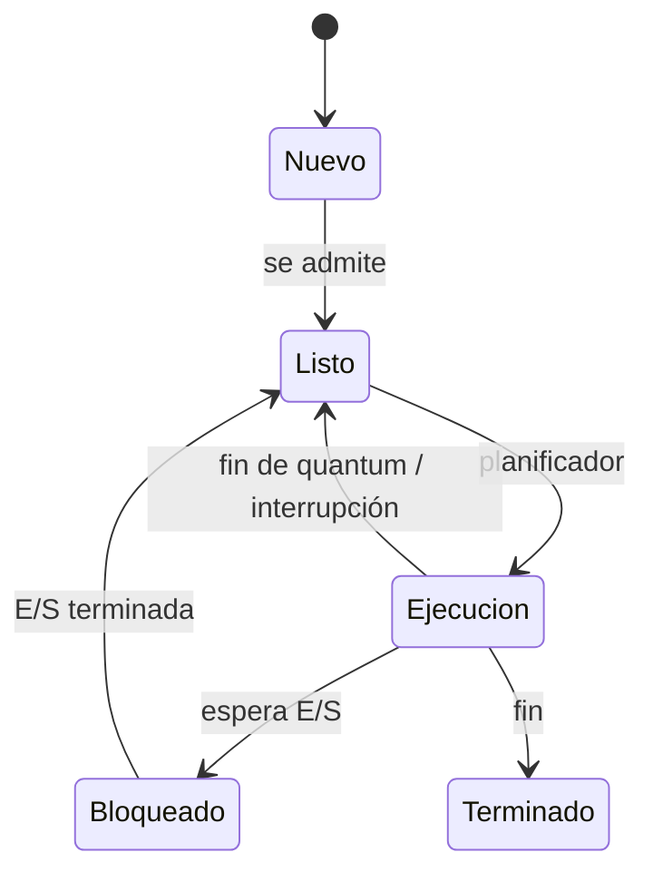

# 2.2.1 Estados de un proceso y transiciones

> [!abstract] En una frase
> Un proceso está en **nuevo, listo, ejecución, bloqueado** o **terminado**. Pasa de uno a otro por decisiones del planificador (listo ↔ ejecución) o por eventos (ejecución → bloqueado al pedir E/S; bloqueado → listo al terminar la E/S).

## Desarrollo

| Transición | Causa |
|---|---|
| Nuevo → Listo | El SO crea el proceso y lo pone en la cola de listos |
| Listo → Ejecución | El planificador le asigna la CPU |
| Ejecución → Listo | Se agota el quantum o llega uno de mayor prioridad |
| Ejecución → Bloqueado | Pide E/S o espera un recurso |
| Bloqueado → Listo | Se completa el evento. **No** pasa directo a ejecución: primero espera su turno |
| Ejecución → Terminado | Termina normalmente o por error |

**Estados suspendidos** (modelos más completos): listo-suspendido y bloqueado-suspendido, cuando el proceso fue llevado a disco por swapping (ver 3.3.2).

## Cómo responderlo en el final
Dibujar el diagrama de 5 estados, marcar las 4 transiciones con su causa, y remarcar que bloqueado → listo no es bloqueado → ejecución.

> [!warning] Errores típicos
> - Dibujar bloqueado → ejecución directamente.

---
Volver a: [[00 Unidad 2 — índice]] · [[00 Tema 2.2 — índice]]

## Gráficos
![[fuente_estados_proceso.png]]

Los gráficos están en `FINALES/Gráficos/`.
