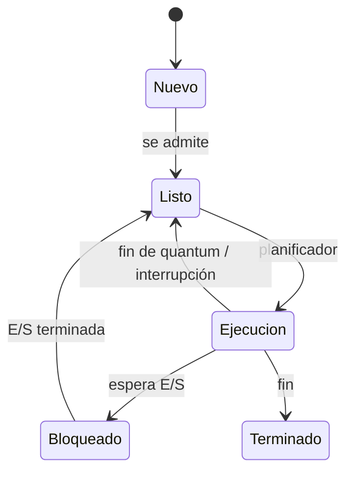

# Unidad 2 — Procesos y planificación — completa

> [!abstract] Qué pide la unidad
> El proceso es la unidad de trabajo del SO: qué es, qué información lo describe, cómo cambia de estado, cómo se reparte la CPU entre varios y cómo se comunican. Incluye el modelo probabilístico de multiprogramación, que es el ejercicio más repetido de los parciales.

> [!info] Cómo leer este archivo
> Es la unidad entera, en orden: Tema → Subtema. Cada subtema tiene su nota propia en la carpeta del tema, por si querés estudiar uno solo.

---

## Tema 2.1 — Proceso y programa

### 2.1.1 Programa vs. proceso

> [!abstract] En una frase
> Un **programa** es un archivo pasivo guardado en disco (código e instrucciones). Un **proceso** es ese programa **en ejecución**: una entidad activa, en memoria, con recursos asociados. Un mismo programa puede dar origen a muchos procesos.

#### Desarrollo
| | Programa | Proceso |
|---|---|---|
| Naturaleza | Pasivo: un archivo | Activo: en ejecución |
| Dónde vive | Memoria secundaria (disco, SSD) | Memoria principal (RAM) |
| Qué contiene | Código y datos iniciales | Código, datos, heap, pila, registros, PCB |
| Cantidad | Uno | Puede haber muchos del mismo programa |

**Qué forma un proceso:** código del programa; datos (variables globales, heap); una o más **pilas** (llamadas y variables locales); registros (contador de programa, puntero de pila, registros generales); y el **PCB** (ver 2.1.2).

**Ejemplo:** abrir tres veces el bloc de notas = un programa, tres procesos.

#### Cómo responderlo en el final
"El programa es el archivo ejecutable en disco; el proceso es la instancia en ejecución, con su código, datos, pila, registros y PCB en memoria. Del mismo programa puede haber varios procesos."

> [!warning] Errores típicos
> - Decir que "el proceso es el programa". Es el programa **en ejecución**.

### 2.1.2 El PCB (Process Control Block)

> [!abstract] En una frase
> El **PCB** es la estructura de datos del SO que guarda todo lo necesario para **retomar** un proceso: su identidad, su estado, sus registros, su información de memoria y de archivos, y sus estadísticas.

#### Desarrollo
| Bloque | Contenido típico |
|---|---|
| Identificación | PID, PID del padre, usuario y grupo propietario |
| Estado | Nuevo, listo, ejecución, bloqueado, suspendido, terminado; prioridad |
| Contexto de CPU | Contador de programa, registros generales, puntero de pila |
| Memoria | Registros base y límite, o punteros a tablas de páginas / segmentos |
| Archivos | Tabla de archivos abiertos, directorio de trabajo |
| Estadísticas | Tiempo de CPU usado, fallos de página, tiempos de espera |

**Cambio de contexto:** el SO **guarda** el estado del proceso que deja la CPU en su PCB y **carga** el PCB del que la toma. Ese trabajo es el costo del cambio de contexto (aparece en 2.4.2 como sobrecarga).

#### Cómo responderlo en el final
Enumerar cuatro bloques (identificación, estado, contexto de CPU, memoria) y explicar que el PCB es lo que permite interrumpir y retomar un proceso.

> [!warning] Errores típicos
> - Confundir PCB con "la tabla de páginas": la tabla de páginas es **un campo** del PCB.

### 2.1.3 Creación, jerarquía y señales

> [!abstract] En una frase
> Los procesos nacen y mueren por **llamadas al sistema**; forman un árbol padre-hijo; cada uno tiene un usuario y un grupo, y se controlan con **señales**, análogas a las interrupciones de hardware.

#### Desarrollo
- **`fork()`:** crea un hijo que es copia del padre. Devuelve 0 en el hijo y el PID del hijo en el padre.
- **`execve()`:** reemplaza el programa del proceso actual por otro. El PID no cambia.
- **`waitpid()`:** el padre espera a que termine un hijo.
- **`exit()`:** termina el proceso y devuelve un código al padre.
- **Señales:** mecanismo de software para notificar eventos (equivalente a una interrupción, pero entregada por el SO al proceso).

Estructura del shell (TP1, pregunta 13): `fork` + `execve` en el hijo y `waitpid` en el padre (ver 1.1.2).

#### Cómo responderlo en el final
"El padre crea al hijo con fork; el hijo reemplaza su imagen con execve; el padre espera con waitpid. Así es como funciona cualquier comando de la línea de comandos."

> [!warning] Errores típicos
> - Olvidar que `execve` **no** crea un proceso nuevo: reemplaza el programa del actual.

---

## Tema 2.2 — Estados, transiciones e interrupciones

### 2.2.1 Estados de un proceso y transiciones

> [!abstract] En una frase
> Un proceso está en **nuevo, listo, ejecución, bloqueado** o **terminado**. Pasa de uno a otro por decisiones del planificador (listo ↔ ejecución) o por eventos (ejecución → bloqueado al pedir E/S; bloqueado → listo al terminar la E/S).

#### Desarrollo

| Transición | Causa |
|---|---|
| Nuevo → Listo | El SO crea el proceso y lo pone en la cola de listos |
| Listo → Ejecución | El planificador le asigna la CPU |
| Ejecución → Listo | Se agota el quantum o llega uno de mayor prioridad |
| Ejecución → Bloqueado | Pide E/S o espera un recurso |
| Bloqueado → Listo | Se completa el evento. **No** pasa directo a ejecución: primero espera su turno |
| Ejecución → Terminado | Termina normalmente o por error |

**Estados suspendidos** (modelos más completos): listo-suspendido y bloqueado-suspendido, cuando el proceso fue llevado a disco por swapping (ver 3.3.2).

#### Cómo responderlo en el final
Dibujar el diagrama de 5 estados, marcar las 4 transiciones con su causa, y remarcar que bloqueado → listo no es bloqueado → ejecución.

> [!warning] Errores típicos
> - Dibujar bloqueado → ejecución directamente.

### 2.2.2 Interrupción y cambio de contexto (pasos)

> [!abstract] En una frase
> Cuando ocurre una interrupción, el hardware guarda el contador de programa, salta a la rutina de atención, el SO guarda registros, decide qué proceso sigue (planificador) y restaura el elegido.

#### Desarrollo
Pasos del nivel inferior del SO ante una interrupción (cátedra, Procesos y memoria):
1. El **hardware** guarda el contador de programa en la pila (y el estado mínimo).
2. El hardware carga el **nuevo contador de programa** desde el vector de interrupciones.
3. Una rutina en **ensamblador** guarda los registros generales.
4. La rutina en ensamblador establece la **nueva pila**.
5. Se ejecuta el **servicio de interrupción en C** (por lo general lee y guarda la entrada en un buffer).
6. El **planificador** decide qué proceso sigue.
7. El procedimiento en C **regresa** al ensamblador.
8. El ensamblador **restaura** el proceso elegido y lo ejecuta.

> [!tip] Cómo recordarlo
> "Hardware guarda y salta → ensamblador guarda registros y pila → C atiende → planificador elige → ensamblador restaura." Son tres capas: hardware, ensamblador, C.

#### Cómo responderlo en el final
Recitar las capas: hardware, ensamblador, C, planificador, y de vuelta. Si piden el detalle, dar los 8 pasos en orden.

---

## Tema 2.3 — Hilos

### 2.3.1 Proceso vs. hilo

> [!abstract] En una frase
> Un **hilo** (thread) es una unidad de ejecución **dentro** de un proceso. Los hilos de un mismo proceso comparten memoria y recursos; cada uno tiene solo su pila, sus registros y su contador de programa. Por eso cambiar de hilo es más liviano que cambiar de proceso.

#### Desarrollo
| | Proceso | Hilo |
|---|---|---|
| Espacio de memoria | Propio y aislado | Compartido con los hilos del mismo proceso |
| Recursos (archivos, PCB) | Propios | Compartidos |
| Propio de cada uno | Todo | Pila, registros, contador de programa, estado |
| Cambio de contexto | Pesado (cambia el mapa de memoria) | Liviano |
| Protección entre sí | Fuerte | Ninguna: un hilo puede corromper a otro |

#### Cómo responderlo en el final
"El proceso es el contenedor con aislamiento; el hilo es la unidad de ejecución que comparte todo con sus hermanos. Cambiar de hilo es más barato porque no cambia el mapa de memoria."

> [!warning] Errores típicos
> - Decir que los hilos "tienen su propia memoria": comparten el espacio de direcciones.

---

## Tema 2.4 — Planificación de la CPU

### 2.4.1 Objetivos de la planificación

> [!abstract] En una frase
> El **planificador** decide qué proceso listo recibe la CPU y por cuánto tiempo. Sus objetivos son usar bien la CPU, responder rápido, reducir la espera y cumplir prioridades o plazos; cuál pesa más depende del tipo de sistema.

#### Desarrollo
Objetivos típicos (parcial, pregunta 21):
- Maximizar la **utilización de CPU**.
- Minimizar el **tiempo de respuesta** (sistemas interactivos).
- Minimizar el **tiempo de espera** promedio en la cola de listos.
- Maximizar el **rendimiento**: procesos terminados por unidad de tiempo.
- Respetar **prioridades** y, en tiempo real, los **plazos**.

**Factores que inciden en la eficiencia** (pregunta 25): el algoritmo, el quantum, la relación CPU/E-S de los procesos, la carga (cantidad de procesos), las prioridades y aging, y el costo del cambio de contexto.

#### Cómo responderlo en el final
Dar el criterio según el tipo de sistema: por lotes → rendimiento; interactivo → respuesta; tiempo real → plazos.

### 2.4.2 FIFO, SJF y Round Robin (quantum)

> [!abstract] En una frase
> **FIFO** atiende en orden de llegada, sin expulsión. **SJF** elige el trabajo más corto (minimiza la espera promedio, pero necesita estimarlo). **Round Robin** da a cada proceso un **quantum** y lo manda al final de la cola si no terminó.

#### Desarrollo
### FIFO / FCFS
- Orden de llegada, **no expulsivo**: el proceso corre hasta terminar o bloquearse.
- Simple, pero un proceso largo que llega primero retrasa a todos (**efecto convoy**).

### SJF (Shortest Job First)
- Ejecuta primero el de **menor tiempo de CPU** estimado. Minimiza la espera promedio.
- Variante expulsiva: **SRTF** (Shortest Remaining Time First).
- Problema: hay que **estimar** el tiempo de cada proceso.

### Round Robin
- Pensado para **sistemas interactivos**. Cada proceso recibe un **quantum** (ej.: 25 ms).
- Si el quantum vence y no terminó, va al **final** de la cola de listos. Si terminó, sale.
- **Expulsivo:** garantiza que todos tengan turno.

**Quantum chico:** muchos cambios de contexto → sobrecarga alta.
**Quantum grande:** el sistema se comporta como FIFO → mala respuesta.

### Ejemplo del parcial (pregunta 23)
Cambio de contexto = 6 ms; quantum = 25 ms. En cada ciclo se gastan 6 ms de sobrecarga y 25 ms útiles:
**sobrecarga = 6 / (6 + 25) = 6 / 31 ≈ 19,4 %.** La cátedra lo considera aceptable porque lo que pesa es la respuesta al usuario.

#### Cómo responderlo en el final
Dar la lógica de cada algoritmo en una línea, y para RR explicar el trade-off del quantum con el ejemplo de 6/31.

> [!warning] Errores típicos
> - Decir que SJF es el mejor para todo: necesita conocer la duración.
> - Olvidar que en RR un proceso que se bloquea antes del quantum cede la CPU antes.

### 2.4.3 Prioridades, hambre y aging

> [!abstract] En una frase
> En **prioridades**, siempre corre el de mayor prioridad. Puede ser **expulsivo** (si llega uno más prioritario, desaloja al actual) o **no expulsivo**. El problema es el **hambre** (starvation) de los de baja prioridad; la solución es el **aging**: subir la prioridad cuanto más espera un proceso.

#### Desarrollo
| Variante | Cuándo cambia la CPU |
|---|---|
| No expulsiva | Cuando el proceso termina o se bloquea |
| Expulsiva | También cuando llega un proceso de mayor prioridad |

- **Hambre:** un proceso de baja prioridad puede no ejecutarse nunca si siempre hay otro más prioritario.
- **Aging:** la prioridad aumenta con el tiempo de espera; garantiza que, tarde o temprano, todos corran.

#### Cómo responderlo en el final
"Las prioridades pueden causar hambre; el aging soluciona el problema subiendo la prioridad de quien espera."

---

## Tema 2.5 — Multiprogramación y modelo probabilístico

### 2.5.1 Multiprogramación — concepto y beneficios

> [!abstract] En una frase
> La **multiprogramación** mantiene **varios procesos en memoria** y alterna la CPU entre ellos: mientras uno espera E/S, otro usa la CPU. Sube la utilización de la CPU y reduce el tiempo muerto.

#### Desarrollo
- **Se incorpora en la 3.ª generación** (década de 1960).
- **Ventajas:** mayor utilización de CPU, menor tiempo de espera promedio, y posibilidad de **tiempo compartido** (varios usuarios "a la vez").
- **Condición:** necesita que haya **más de un proceso** en memoria y que los procesos pasen parte del tiempo en E/S.
- **Lo que hay que decidir:** cuántos procesos conviene tener en memoria para mantener la CPU ocupada. Esa pregunta la responde el modelo probabilístico (2.5.2).

#### Cómo responderlo en el final
Definición + "mientras uno espera E/S, otro usa la CPU" + la pregunta de cuántos procesos, que lleva a 2.5.2.

### 2.5.2 Modelo probabilístico — U = 1 − pⁿ

> [!abstract] En una frase
> Si cada proceso pasa una fracción **p** de su tiempo esperando E/S y hay **n** procesos en memoria, la CPU está ociosa solo cuando **todos** esperan a la vez, con probabilidad **pⁿ**. Entonces la **utilización de CPU es U = 1 − pⁿ**.

#### Desarrollo
Supone que los procesos son independientes (cátedra, Procesos y memoria; parcial, preguntas 5, 24, 31 y 35).

| Símbolo | Significado |
|---|---|
| p | Fracción de tiempo de cada proceso **en espera de E/S** ("qué tan dependientes de E/S son") |
| n | Cantidad de procesos **en memoria** ("cuántos hay listos para aprovechar la CPU") |
| U | Fracción de tiempo en que la CPU está ocupada |

### Tabla para p = 0,5
| n | pⁿ | U = 1 − pⁿ |
|---|---|---|
| 1 | 0,5 | 50 % |
| 2 | 0,25 | 75 % |
| 3 | 0,125 | 87,5 % |
| 4 | 0,0625 | 93,75 % |

**Pregunta típica:** "¿cuántos procesos para tener al menos 90 % de CPU con p = 0,5?" → 1 − 0,5ⁿ ≥ 0,9 ⇒ 0,5ⁿ ≤ 0,1 ⇒ **n = 4** (0,5³ = 0,125 > 0,1; 0,5⁴ = 0,0625 ≤ 0,1).

### Otros ejemplos de la cátedra
- p = 0,75, n = 2: U = 1 − 0,5625 = **43,75 %**.
- p = 0,9, n = 3: U = 1 − 0,729 = **27,1 %**.
- p = 0,75 y **4 procesos** (TP2, pregunta 6): la CPU desperdicia 0,75⁴ = **31,6 %**, o sea U ≈ 68,4 %.
- p = 0,7 (TP2, pregunta 7): con 3 procesos U = 1 − 0,7³ = **65,7 %**; con 5, U = 1 − 0,7⁵ = **83,2 %**.

### Limitaciones que conviene decir en el examen escrito
- Supone independencia entre procesos.
- No modela la **memoria**: en la práctica, n está limitado por cuántos procesos entran en RAM (ver Unidad 3).
- Es una **estimación**; las simulaciones (TP2, pregunta 9) reproducen el comportamiento con más detalle.

#### Cómo responderlo en el final
"Si cada proceso espera E/S con probabilidad p, la CPU queda ociosa sólo si los n esperan a la vez: pⁿ. Entonces U = 1 − pⁿ." Y después un ejemplo numérico de la tabla.

> [!warning] Errores típicos
> - Confundir p (fracción en E/S) con la fracción de CPU (1 − p).
> - Calcular 1 − p·n en vez de 1 − pⁿ.

---

## Tema 2.6 — Comunicación y sincronización entre procesos

### 2.6.1 Comunicación entre procesos (IPC)

> [!abstract] En una frase
> Los procesos se comunican por **pipes**, **colas de mensajes**, **memoria compartida** o **sockets**. Cada mecanismo cambia el costo y la necesidad de sincronizar.

#### Desarrollo
| Mecanismo | Cómo funciona | Ejemplo / nota |
|---|---|---|
| **Pipe** (tubería) | Un proceso escribe y otro lee; unidireccional (dos pipes para bidireccional) | `ls \| grep txt` en el shell |
| **Cola de mensajes** | El SO mantiene buzones; los procesos envían y reciben mensajes con formato | Buena para sistemas modulares o distribuidos |
| **Memoria compartida** | Varios procesos comparten una región de RAM | El método más rápido, pero **requiere sincronización** |
| **Socket** | Comunicación tipo red, también dentro de la misma máquina | Cliente / servidor |

#### Cómo responderlo en el final
Nombrar los cuatro, dar un ejemplo de pipe en el shell y remarcar que la memoria compartida exige semáforos o mutex.

### 2.6.2 Sincronización y condiciones de carrera

> [!abstract] En una frase
> Cuando varios procesos o hilos usan el mismo dato sin control, el resultado depende del orden de ejecución: es una **condición de carrera**. La **sincronización** (regiones críticas, semáforos, mutex, monitores) la evita.

#### Desarrollo
- **Condición de carrera:** dos procesos leen y escriben la misma variable; uno puede leer un valor "a medio actualizar" o pisar el cambio del otro.
- **Región crítica:** el fragmento de código que accede al recurso compartido. Debe ejecutarse de a uno.
- **Herramientas:** **mutex** (exclusión mutua), **semáforos** (contadores), **monitores** (estructuras con sincronización incorporada); algoritmos de software como Peterson o hardware como TSL.
- **Ejemplo clásico:** el **productor–consumidor** con buffer compartido.
- Riesgos a mencionar: **interbloqueo** (deadlock) y **espera activa** innecesaria.

#### Cómo responderlo en el final
Definir la carrera con un ejemplo de dos procesos que incrementan la misma variable, y luego nombrar región crítica y semáforo/mutex.

